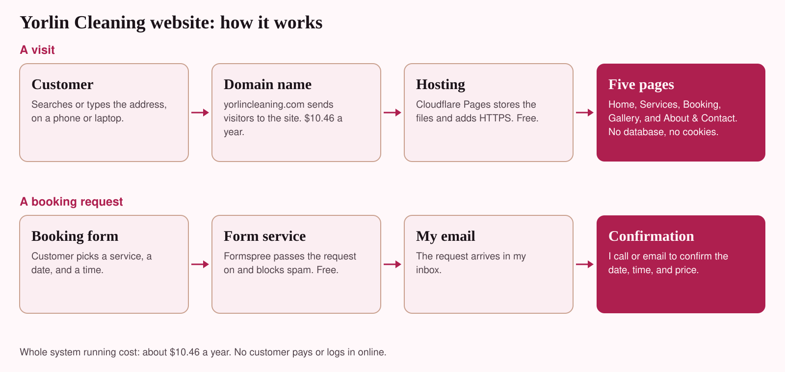
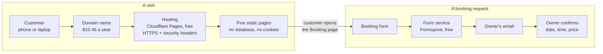

# Architecture

The website is a **static site**: a folder of plain HTML, CSS, and one small JavaScript file. There is no database, no server code, and no login. That keeps it cheap, fast, and hard to attack.

The same diagram as code (GitHub draws it automatically):

## The parts and what each one does

| Part | What it does | Cost |
| --- | --- | --- |
| Domain name | The web address. DNS records point it to the host. | $10.46 per year |
| Hosting (Cloudflare Pages) | Stores the files, serves them over HTTPS, and applies the security headers in `site/_headers`. | $0 |
| Static pages (`site/*.html`) | Home, Services, Booking, Gallery, About & Contact, and a 404 page. | $0 |
| One script (`site/js/main.js`) | Runs the forms and fills in the footer year. Nothing else. | $0 |
| Form service (Formspree) | Receives a booking request and forwards it to email. Blocks spam. | $0 for 50 a month |
| Owner's email | Where requests arrive. The owner confirms by phone or email. | $0 |

## What happens when a customer sends a request

1. The customer fills in the booking form on `booking.html`.
2. `main.js` checks that the form is complete and that the hidden spam field is empty.
3. If a Formspree address is set in the form's `data-endpoint`, the request is sent there and arrives in the owner's email.
4. If no address is set yet, or the service is unreachable, the visitor's email app opens with the request filled in, and the page shows the phone number.
5. The owner calls or emails to confirm the date, time, and price. The booking is final only after that.

## Security design

| Risk | Control |
| --- | --- |
| Injected or third-party scripts | Content Security Policy allows scripts, styles, and images only from the site itself (`site/_headers`). |
| Another site framing this one | `X-Frame-Options: DENY` and `frame-ancestors 'none'`. |
| Visitor tracking | No cookies, analytics, outside fonts, or embeds. Referrer policy limits what is shared. |
| Insecure connections | HTTPS from the host, `upgrade-insecure-requests`, and an HSTS header. |
| Form spam | Hidden spam-trap field, message length limits, and Formspree's own filtering. |
| Form data sent to the wrong place | The script accepts only `https://formspree.io/f/...` addresses and ignores anything else. |
| Sensitive data | No payments, accounts, or card numbers anywhere. The form tells people not to send them. |

These controls were checked in a browser with the headers switched on: no policy violations on any page, the form accepted a Formspree address and rejected another, and the spam trap sent nothing.

## Design decisions

- **Static instead of WordPress or a builder.** Lowest cost, nothing to patch, easy to move. See [cost-analysis.md](cost-analysis.md).
- **Booking requests instead of a live calendar.** A real calendar needs a server or a paid service. The owner confirms each request.
- **No map or reviews widget.** They load third-party code that tracks visitors. The page lists the service area in text instead.
- **System fonts.** Nothing is fetched from outside, so pages load fast and the policy stays strict.
- **No invented content.** Prices, hours, photos, and reviews are added only when they are real.

## Limitations

- Only one person (the owner) confirms bookings, so there is no automatic availability check.
- Editing needs basic HTML. The [go-live guide](go-live-guide.md) shows where to change things.
- The GitHub Pages host ignores `_headers`, so use Cloudflare Pages or Netlify to get the security rules.
